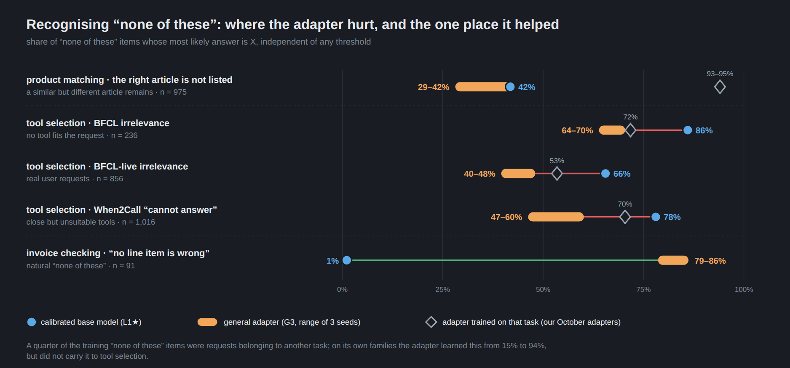
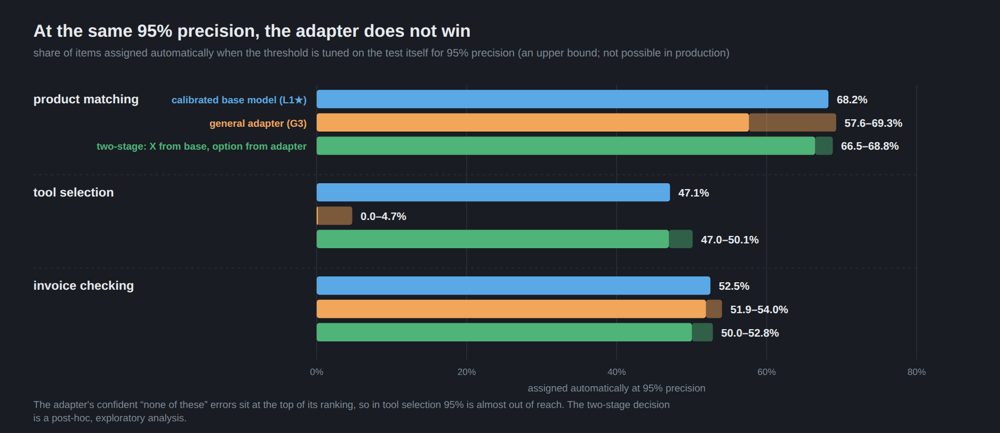

# A general Hungarian decision adapter does not transfer to held-out task groups — a pre-registered negative result (Qwen3.6-35B-A3B-FP8, GB10)

**Date:** 2026-10-07 → 2026-10-15 · **Reproducibility:** R1 (code, training and validation data, the three adapter
seeds; per-item read-outs are not published here, so the numbers are checked by hash and against the machine outputs,
not recomputed; see §7) · **Card:** [eval-card.yaml](eval-card.yaml) · **Decision:** [decision-record.md](decision-record.md)
· **Pre-registered protocol (Hungarian):** [protocol/](protocol/) · **Adapter (research artifact, not for use):**
[`Qwen3.6-35B-A3B-hu-general-decision-lora-negative-result`](https://huggingface.co/k3dani/Qwen3.6-35B-A3B-hu-general-decision-lora-negative-result)
· **Training and validation data:** [`hu-general-decision-mix`](https://huggingface.co/datasets/k3dani/hu-general-decision-mix)
(Hugging Face) · **Previous round:** [decision-lora-where-to-train-gb10](../2026-10-09-decision-lora-where-to-train-gb10/)

> One small decision adapter, trained on many Hungarian (and 25 % English) task families, was tested on three task
> groups it never saw: matching invoice lines to catalogue articles, tool selection, and questions about synthetic
> invoices. The bar was the same model untrained and carefully calibrated. The adapter acted on **7.2 to 11.1 points**
> more items on every group, but its precision stayed at **0.866–0.912**, below the pre-registered 0.93 failure line,
> on all three. The pre-registered verdict is "does not meet the requirements" on every layer. On items that have a
> correct option it was as precise as the base model; the errors come from "none of these" items it confidently
> assigned to an option.

---

## 1. What was the measurement for?

The previous round ([decision-lora-where-to-train-gb10](../2026-10-09-decision-lora-where-to-train-gb10/)) trained a
task-specific decision adapter twice with one recipe: on invoice-line matching it automated 13.7 points more than the
calibrated base model, on tool selection it lost to it. Both adapters needed their own labelled data and their own
validation set. A new task in DocAI usually has neither.

This round asked whether **one adapter trained on many task families** brings that kind of gain to a family it has
not seen, how much of a task-specific adapter's gain it recovers on the same test, and whether its calibration (a
temperature and a threshold fitted on the shared validation set) carries over to a new family that has no validation
set of its own. It also tested two fixes for round 2's failure: training four kinds of "none of these" instead of
mostly the forced kind, and an anchor that keeps the adapter close to the base model on "none of these" items.

The protocol — hypotheses, verdict rules, primary endpoints, statistics, layers and calibration samples — was frozen
as **v1 on 2026-10-14 10:08**, with a sha256 manifest of the analysis code, the item files, the calibration samples,
the training mix and the validation read-outs ([protocol/v1/](protocol/v1/)). At that point the held-out (F4) results
of the trained arms and every comparison were **not viewed**. What was known: the calibrated base model's results on
the held-out layers, the earlier rounds' results (including the task-specific adapters on their own tests), and the
trained arms' validation results. The held-out read-outs were sealed: they started on 2026-10-13, before the freeze,
each file's sha256 was appended to a seal file as soon as it finished, and the analysis ran only after the freeze,
through a chain that first checked the manifest. Later changes are dated in the protocol log (`Napló`), mistakes
included.

## 2. On what task and dataset?

The decision has the same form as in the previous round: a state, a question and 2–10 options labelled `A`–`J`,
plus `X` ("none of these"). The answer is one label token; its probability restricted to the labels present is the
confidence. Two-option yes/no questions (`noul`) use the same form.

**Training data** ([`hu-general-decision-mix`](https://huggingface.co/datasets/k3dani/hu-general-decision-mix), train
split): 17 500 items, 13 125 Hungarian and 4 375 English typed decisions (25 %). 9.25 % (1 619) have gold `X`, of four
kinds: the gold removed from a list that keeps a close but different option (59 % of the `X` items), natural
"unanswerable" marked by the source, an out-of-scope request next to a superficially close list, and a missing
precondition. 30 % of the items are trained with permuted options.

- **Sources:** Hungarian human-labelled sets (HuLU tasks, MILQA, HuRC, MultiEURLEX, NerKor), public Hungarian text
  (EU procurement notices, the National Legislation Database, Wikipedia) with gold from the source's metadata or the
  text's structure, seven synthetic families, and a licence-filtered English typed-decision backbone.
- **Synthetic families** were generated by Apache-2.0 models and checked by a different-family Apache-2.0 model; the
  subject's family (Qwen) neither generated nor checked any item.
- **Excluded:** two sources whose machine-estimated label noise exceeded the pre-set 10 % gate (HuSST 13.3 %,
  HuCommitmentBank 24.7 %), one source translated by a closed model (HuBoolQ), any closed-model output as a label or
  target, and any customer or tenant data.
- **No new human review** in this round. Training labels come from the sources, from construction, or from checked
  generation; confirmatory claims rest only on the three held-out groups below.

The **validation split** (3 122 items, the same Hugging Face dataset) is where every arm's temperature and threshold
were chosen. The dataset ships in two licence configurations (permissive and share-alike).

**Held-out groups.** Each group was kept out of training as a whole, with every related source (by source name), so
a sibling source could not leak it.

| group | what it is | items | scored | of which "none of these" | clusters |
|---|---|---|---|---|---|
| **HO-termék** (product) | round 1's public, human-reviewed test: invoice line → catalogue article, four layers + 16 new suppliers ([dataset](https://huggingface.co/datasets/k3dani/hu-invoice-catalog-decisions)) | 5 441 | 4 524 | 1 103 | 2 759 |
| **HO-routing** | round 2's confirmatory test: BFCL (incl. irrelevance and live), When2Call, the reviewed part of the Hungarian MASSIVE layer, the Hungarian tool catalogue | 7 493 | 7 416 | 2 454 | 4 169 |
| **HO-új** (new) | KIE/validation on synthetic Hungarian invoices: totals and VAT (`kie.összeg`), dates (`kie.dátum`), fields (`kie.mező`); gold computed in Python and recomputed independently from the rendered text by a unit test | 2 200 | 2 200 | 306 | 2 200 |

For H3(b), a calibration sample was set aside from each group before the freeze: HO-termék 200 items (169 scored,
105 clusters), HO-routing 146 (145 scored, 82 clusters), HO-új 200. They are not part of the test layers. Descriptive
layers (in-distribution test-ID, one held-out procurement category, external evals) were also read out; only the
in-distribution one (H5) is reported here.

## 3. Which models and configurations were compared?

One served model, `Qwen/Qwen3.6-35B-A3B-FP8`, without speculative decoding, on vLLM 0.30.0 (the same image as the
previous round), one DGX Spark (GB10, 128 GB). Every arm, the base model included, ran on a LoRA-enabled server,
because enabling LoRA switches the MoE kernel (previous round). Thinking off, one forward pass, label-token
log-probabilities. HO-termék and HO-routing used their original round-1/round-2 prompts; the other layers used this
round's generic "state / question / options" frame.

| arm | what it is |
|---|---|
| **`L1★` calibrated base** | the base model's label probabilities averaged over four option orders, temperature 1.431 fitted on validation, τ@95 = 0.716 — **the baseline of H1** |
| `L0′` | the same read-out and calibration on a fresh vLLM instance at the end of the queue — measures instance noise |
| **`G3` general adapter** | LoRA r16, α 32, lr 1e-4, 1 epoch, grad-accum 16, on the attention and GatedDeltaNet projections and the shared-expert MLP (no LoRA on the routed experts), as in the previous round; loss: cross-entropy on the gold (ε = 0.05) + 0.5·Brier + 0.5·KL(p_L1★ ‖ p_adapter) on the `X`-gold items (the **base anchor**); trained in BF16 on a de-quantised copy, served on the FP8 checkpoint; **three seeds**, each with its own calibration arm, temperature and τ@95 chosen on validation |
| `G3-kemény` (hard) | G3 without the anchor (β = 0), seed 1 — the anchor ablation |
| `G3-hu` | G3 without the English backbone (13 125 items), seed 1 — H4 |
| `L3-spec` (reference) | the previous round's task-specific adapters on their own test, each with its own round's calibration: round 1's invoice adapter on HO-termék, round 2's tool-selection adapter on HO-routing (three seeds each) |

The protocol planned a soft target from an Apache-2.0 teacher model. None of the four candidates (Mistral Small 4,
Gemma 4 26B-A4B, the subject itself in thinking mode, Qwen3.8-27B) passed the pre-set teacher gate, so the trained
recipe is gold + anchor without a teacher. A descriptive reference arm with an external English decision LoRA
(JPT-35B-A3B) and a thinking-mode re-decision arm were planned and not run.

Validation thresholds (τ@95): L1★ 0.716; G3 s1 0.786, s2 0.759 (raw arm), s3 0.760; G3-kemény 0.759; G3-hu 0.850.
L3-spec on its own validation set: round 1 0.275–0.343, round 2 0.339–0.496.

## 4. Which metrics?

- **Coverage at 95 % precision (`lef@95`, primary):** the share of scored items whose top label is not `X` and whose
  confidence is at least τ. τ is chosen on the validation set as the smallest threshold above which the one-sided
  95 % Clopper–Pearson lower bound of precision is at least 0.95.
- **Precision:** the share of accepted items that are correct. Below **0.93** is a precision failure (⚠).
- **AURC (co-primary):** area under the risk–coverage curve of the arm's own non-`X` decisions.
- **`X` recall** (`X-fedés`): the share of "none of these" items whose top label is `X`, threshold-free.
- **ECE** (15 equal-mass bins) and top-1 accuracy, descriptive.
- **Statistics:** hierarchical bootstrap (seed × cluster), 10 000 replicates. The validation set and the calibration
  samples are resampled by cluster and τ is re-chosen in every replicate; compared arms share the cluster sample. Two-sided
  p = 2·min(P(Δ ≤ 0), P(Δ ≥ 0)); Holm correction over H1's six tests (three layers × two endpoints), α = 0.05.
  Intervals are conditional on the read-out mode and temperature chosen on validation.
- **H1 verdict per layer, in this order:** "does not meet the requirements" (`nem teljesíti a követelményeket`) if the
  G3 precision averaged over the three seeds is below 0.93 at the validation τ, or either endpoint is significantly
  against G3 after Holm; "generalises" if not, and at least one endpoint improves significantly after Holm with all
  three seeds on the favourable side; otherwise "undecidable".
- **H2** (vs the task-specific adapter): D = [lef(G3) − lef(L1★)] − 0.5 × [lef(L3-spec) − lef(L1★)]; "substantial
  transfer" (`érdemi átvitel`) if D's lower bound is above 0. Coverage only, without a precision condition. The gain
  ratio (G3's gain over L3-spec's gain) is our own, descriptive measure.
- **H3** (calibration transfers): (a) at the validation τ; (b) at a τ chosen on the group's calibration sample with
  the same rule. "Met the prescribed tolerance threshold" if the seed-averaged G3 precision is ≥ 0.93 — not a proof of
  95 % precision. No valid τ on the sample means no accepted item: not a success.
- **H4** English backbone (G3 s1 vs G3-hu s1, H1's rule on one seed), **H5** in-distribution test (descriptive),
  **H6** the anchor (exploratory).
- **Pre-registered sensitivity (MDE, 80 % power):** H1 coverage 6.6 / 6.5 / 6.8 points and AURC 0.0040 / 0.0031 /
  0.0058 on HO-termék / HO-routing / HO-új; 85–89 % of the coverage variance comes from choosing τ.

## 5. What was the result?

Full sheets (Hungarian): the hand-written results page with interpretation
[protocol/03-F4-eredmenylap.md](protocol/03-F4-eredmenylap.md) and the machine sheet
[results/eredmenylap_gepi.md](results/eredmenylap_gepi.md).

### 5.1 Technical closure (before the analysis)

All 25 required read-outs were complete, with no duplicate or invalid row, and every row carried its arm's model
name. Two G3 seeds had lost rows in the held-out read-out (s1: 5 545 pairs, 1 387 items; s3: 2 206 pairs, 553 items,
all on HO-routing) to a thread-safety bug in loading the round-2 prompt frame; the missing pairs were re-read with
the fixed loader, append-only, and exactly the pairs in the error log. The original rows' prefix matches the seal and
the final seal file starts with the snapshot taken at the freeze. Instance noise (L0′ − L1★): top-1 flips 1.2–3.5 %,
|Δlef@95| ≤ 0.2 points, so the L0′ rule never applied. No main contrast's point estimate falls outside its own
bootstrap CI.

### 5.2 The arms on the held-out groups (point estimates, validation τ)


**HO-termék** — 4 524 scored, 1 103 "none of these"

| arm | lef@95 | precision | AURC | ECE | `X` recall | top-1 |
|---|---|---|---|---|---|---|
| L1★ (permutation average, T = 1.431) | 0.653 | 0.963 | 0.0296 | 0.058 | 0.415 | 0.824 |
| L0′ (fresh instance) | 0.654 | 0.964 | 0.0293 | 0.057 | 0.419 | 0.825 |
| G3, mean of 3 seeds [range] | 0.761 [0.744–0.794] | 0.912 ⚠ [0.878–0.933] | 0.0434 | 0.062 | 0.340 | 0.809 |
| G3-kemény s1 | 0.740 | 0.921 ⚠ | 0.0365 | 0.054 | 0.395 | 0.817 |
| G3-hu s1 | 0.722 | 0.942 | 0.0378 | 0.062 | 0.327 | 0.810 |
| L3-spec (round 1), mean of 3 seeds [range] | 0.756 [0.750–0.764] | 0.973 [0.967–0.976] | 0.0016 | 0.013 | 0.942 | 0.965 |

**HO-routing** (round 2's confirmatory test) — 7 416 scored, 2 454 "none of these"

| arm | lef@95 | precision | AURC | ECE | `X` recall | top-1 |
|---|---|---|---|---|---|---|
| L1★ (permutation average, T = 1.431) | 0.644 | 0.918 ⚠ | 0.0343 | 0.023 | 0.765 | 0.889 |
| L0′ (fresh instance) | 0.644 | 0.918 ⚠ | 0.0359 | 0.023 | 0.762 | 0.888 |
| G3, mean of 3 seeds [range] | 0.732 [0.730–0.733] | 0.866 ⚠ [0.861–0.870] | 0.0816 | 0.064 | 0.570 | 0.840 |
| G3-kemény s1 | 0.738 | 0.858 ⚠ | 0.0844 | 0.074 | 0.529 | 0.827 |
| G3-hu s1 | 0.681 | 0.898 ⚠ | 0.0589 | 0.049 | 0.712 | 0.880 |
| L3-spec (round 2), mean of 3 seeds [range] | 0.768 [0.759–0.774] | 0.838 ⚠ [0.831–0.844] | 0.0641 | 0.090 | 0.670 | 0.865 |

**HO-új** (KIE/validation) — 2 200 scored, 306 "none of these"

| arm | lef@95 | precision | AURC | ECE | `X` recall | top-1 |
|---|---|---|---|---|---|---|
| L1★ (permutation average, T = 1.431) | 0.568 | 0.938 | 0.0717 | 0.043 | 0.353 | 0.721 |
| L0′ (fresh instance) | 0.567 | 0.939 | 0.0716 | 0.045 | 0.369 | 0.718 |
| G3, mean of 3 seeds [range] | 0.636 [0.620–0.661] | 0.905 ⚠ [0.892–0.916] | 0.0444 | 0.074 | 0.653 | 0.745 |
| G3-kemény s1 | 0.635 | 0.906 ⚠ | 0.0410 | 0.088 | 0.611 | 0.744 |
| G3-hu s1 | 0.592 | 0.926 ⚠ | 0.0467 | 0.055 | 0.732 | 0.755 |

⚠ precision below 0.93. As in round 2, the calibrated base model itself misses the line on HO-routing.

### 5.3 The pre-registered hypotheses

Δ values for H1, H4 and H6 are bootstrap medians with 95 % intervals, as in the machine sheet; they need not equal the
difference of the rounded point estimates in §5.2. H2 reports point estimates.

| hypothesis | verdict | details |
|---|---|---|
| **H1 — HO-termék** | **does not meet the requirements** | precision 0.912 < 0.93; Δlef@95 +11.1 points [6.9; 16.1], p < 0.0001; ΔAURC +0.014 [0.002; 0.027], p = 0.016 (against G3, significant after Holm) |
| **H1 — HO-routing** | **does not meet the requirements** | precision 0.866; Δlef@95 +8.9 points [6.7; 11.3]; ΔAURC +0.047 [0.039; 0.057] (against G3) |
| **H1 — HO-új** | **does not meet the requirements** | precision 0.905; Δlef@95 +7.2 points [3.7; 11.0]; ΔAURC −0.027 [−0.033; −0.022] (in G3's favour) |
| H2 — HO-termék | substantial transfer (coverage only) | L3-spec − L1★ +10.3 points [6.3; 15.3]; D +5.7 points [2.5; 9.7]; gain ratio (descriptive) 1.05 [0.73; 1.62] |
| H2 — HO-routing | substantial transfer (coverage only) | L3-spec − L1★ +12.4 points [9.6; 15.1]; D +2.6 points [0.7; 4.9]; gain ratio 0.71 [0.55; 0.94] |
| H3(a) validation τ | **not met** on all three layers | precision [CI]: HO-termék 0.912 [0.875; 0.941], HO-routing 0.866 [0.846; 0.882], HO-új 0.905 [0.880; 0.925] |
| H3(b) calibration-sample τ | HO-termék, HO-routing: **no valid τ, not a success**; HO-új: **met** | no τ in 90 % (HO-termék) and 97 % (HO-routing) of the replicates either; HO-új: precision 0.975 [0.938; 0.989], coverage 0.34–0.52 by seed (L1★: 0.976 / 0.50) |
| H4 — HO-termék | does not meet the requirements | G3 s1 precision 0.924; ΔAURC +0.005 [0.002; 0.009] (worse with English); Δlef +2.5 points [−0.3; 5.9] |
| H4 — HO-új | does not meet the requirements | G3 s1 precision 0.916; Δlef +2.9 points [1.4; 5.4]; ΔAURC −0.003 [−0.009; 0.002] |
| H4 — HO-routing, Hungarian part | helps | ΔAURC −0.0026 [−0.0048; −0.0010]; Δlef +0.6 points [−1.6; 3.0]; G3 s1 precision 0.964 |
| H5 (descriptive) | — | lef@95 rises on all 23 in-distribution test families; precision falls on the legal families (MultiEURLEX 0.78 → 0.68, NJT chapter 0.93 → 0.77, NJT title 0.95 → 0.87) |
| H6(a) `X` recall kept within −2 points | **not shown**, neither for G3 nor for G3-kemény | G3 − L1★: HO-routing −19.3 points [−24.3; −15.5], HO-termék −7.6 points [−13.8; −0.4]; G3-kemény − L1★: −23.6 [−25.3; −21.9] and −2.0 [−4.5; 0.4] |
| H6(b) anchor (G3 s1 − G3-kemény s1) | exploratory | HO-routing: `X` recall −1.1 points [−2.2; −0.1], AURC −0.006 [−0.010; −0.003]; HO-termék: `X` recall −6.7 points [−8.8; −4.6], AURC +0.007 [0.004; 0.010] |
| H6(c) 51 relabelled routing items | descriptive | gives the old label (of which above τ): L1★ 13 (6), G3 12–15 (8–10), G3-kemény 15 (10), G3-hu 17 (12), round-2 L3 26–29 (all) |

- **The verdict is the same on every layer and every route.** G3 accepts significantly more everywhere, but at the
  validation τ its precision is below 0.93 on all three groups. AURC is also significantly worse on HO-termék and
  HO-routing, and better on HO-új. Seed 3 just reaches the line on HO-termék (0.933); the verdict uses the seed mean.
- **H2 says "substantial transfer" and nothing rests on it.** It compares coverage only. On HO-termék G3 reaches that
  coverage at 0.91 precision, round 1's adapter at 0.97, and with a ~27 times larger AURC; on HO-routing the reference
  fails too (0.84). A pre-registered rule, left as written.
- **Sensitivity blocks (pre-registered).** The draft's HO-routing layer, which still contained the unreviewed MASSIVE
  remainder (9 638 scored; corrected before the freeze, before any result was seen): G3 precision 0.882, Δlef@95 +8.3
  points [6.0; 10.8], ΔAURC +0.041 — same verdict. Re-read HO-routing items (1 363): G3 precision 0.952, Δlef +5.5
  points; the rest (6 053): 0.842 and +9.7 points. The re-read items are the first block of the file (BFCL simple,
  multiple, irrelevance, live simple, part of live multiple), so the difference comes from source composition; an
  instance effect cannot be separated from it.

### 5.4 Where the errors come from (post hoc, descriptive)



Point estimates at the validation τ; G3 is the mean of three seeds ([results/f4_leiro03.json](results/f4_leiro03.json)).

| layer | arm | accepted errors on "none of these" / on a wrong option | precision on items with a correct option | "none of these" items accepted | errors at ≥ 0.95 confidence | risk at 0.5 coverage |
|---|---|---|---|---|---|---|
| HO-termék | L1★ | 101 / 8 | 0.997 | 9.2 % | 5 (5 %) | 0.018 |
| | G3 | 277 / 30 | 0.991 | 25.1 % | 69 (23 %) | 0.025 |
| | G3-kemény | 236 / 28 | 0.991 | 21.4 % | 75 (28 %) | 0.023 |
| | L3-spec (round 1) | 63 / 30 | 0.991 | 5.7 % | 19 (20 %) | 0.001 |
| HO-routing | L1★ | 368 / 23 | 0.995 | 15.0 % | 151 (39 %) | 0.049 |
| | G3 | 694 / 35 | 0.993 | 28.3 % | 375 (51 %) | 0.085 |
| | G3-kemény | 735 / 44 | 0.991 | 30.0 % | 404 (52 %) | 0.090 |
| | L3-spec (round 2) | 802 / 123 | 0.975 | 32.7 % | 521 (56 %) | 0.078 |
| HO-új | L1★ | 13 / 65 | 0.947 | 4.2 % | 3 (4 %) | 0.025 |
| | G3 | 24 / 109 | 0.921 | 7.8 % | 58 (43 %) | 0.026 |

- **On items with a correct option, G3 is as precise as the base model** (0.991–0.993 against 0.995–0.997 on
  HO-termék and HO-routing; 0.996–1.000 on BFCL's plain calls), and it decides more. Its coverage gain comes mostly from
  these items.
- **The precision drop on HO-termék and HO-routing comes entirely from "none of these" items.** G3 assigns 25 % of
  them to an option above τ on HO-termék and 28 % on HO-routing; the base model 9 % and 15 %. 23 % and 51 % of G3's
  accepted errors carry ≥ 0.95 confidence (base: 5 % and 39 %). This is round 2's irrelevance failure, now in a model
  that never saw the routing group; the results page reads it as a product of decision training rather than of a
  task-specific training mix.
- **Tool irrelevance gets worse despite the trained out-of-scope type.** `X` recall on HO-routing by source:

  | source | n (of which "none of these") | L1★ | G3 | G3-kemény | G3-hu | L3-spec (round 2) |
  |---|---|---|---|---|---|---|
  | BFCL irrelevance | 236 (236) | 0.860 | 0.672 | 0.636 | 0.814 | 0.718 |
  | BFCL-live irrelevance | 856 (856) | 0.655 | 0.449 | 0.428 | 0.588 | 0.535 |
  | When2Call | 3 324 (1 016) | 0.781 | 0.544 | 0.470 | 0.748 | 0.704 |

  Out-of-scope `X` was the second most frequent type in training (394 items, 24 % of the 1 619). It did not transfer to
  held-out tool irrelevance; G3 is worse here than round 2's task-specific adapter (`X` recall 0.57 against 0.67).
  G3-hu, without the English backbone, degrades much less (When2Call 0.75, BFCL-live irrelevance 0.59). That is a post
  hoc observation — H4 measured only the Hungarian part of HO-routing — and suggests that the English typed decisions
  push the model towards "call it" on English tool-selection items.
- **On HO-termék, the round-1 kind of "none of these" does not transfer.** Round 1's adapter, trained on that kind in
  that domain, recognises 94 % of HO-termék's "none of these" items; the base model 42 %, G3 34 %. G3 carries "there
  is a similar candidate, pick it" over to invoice lines; the legal families of H5 show the same in distribution. By
  sub-layer, G3's precision is 0.881 (near category branch) to 0.935 (far branch) with non-`X` precision 0.988–0.995
  everywhere; on new suppliers G3 0.906, L1★ 0.960.
- **On HO-új the failure is different.** G3 recognises "none of these" better than the base model and its AURC is
  better. Precision fails because of one arithmetic family:

  | family | L1★ lef / precision / `X` recall | G3 | G3-hu |
  |---|---|---|---|
  | `kie.dátum` (dates) | 0.580 / 0.983 / 0.500 | 0.648 / 0.969 / 0.651 | 0.596 / 0.995 / 0.811 |
  | `kie.mező` (fields) | 0.884 / 0.989 / 0.758 | 0.899 / 0.983 / 0.783 | 0.889 / 0.988 / 0.818 |
  | `kie.összeg` (totals) | 0.235 / 0.628 / 0.037 | 0.358 / 0.594 / 0.590 | 0.287 / 0.590 / 0.627 |

  Every arm is weak on totals (0.59–0.63), because the task is arithmetic and does not work without thinking; G3
  accepts more there (0.24 → 0.36) at the same poor precision. On dates and fields G3's precision is 0.97–0.98. HO-új
  therefore shows that a layer verdict can hinge on one bad family more than that G3 generalises badly.
- **Seeds.** Coverage varies little across seeds (HO-routing 0.730–0.733), precision a lot on HO-termék
  (0.878–0.933). Seed 2's validation-selected calibration arm (raw) explains part of it: with the permutation-average
  arm the other seeds use (T = 0.878, τ = 0.767) its precision would be 0.908 instead of 0.878 on HO-termék, 0.912
  instead of 0.892 on HO-új and 0.864 instead of 0.870 on HO-routing. It would not change the verdict on any layer.

### 5.5 Calibration did not transfer, and the target-layer sample did not rescue it

G3's validation τ (0.76–0.79) is too permissive on the held-out groups. With τ fitted on its own test (an upper
bound, not a deployable setting), G3's coverage at 95 % precision on HO-routing would be 0.00–0.05, the base model's
0.47: the confident "none of these" errors sit at the top of the ranking, so 95 % precision is practically out of
reach. For the same reason the 200-item calibration sample finds no τ (H3(b)): the Clopper–Pearson rule needs about 60
error-free acceptances in a row at the top of the ranking, and the confident errors prevent that. Even the base model
finds such a τ in only 27–53 % of the replicates. Round 2's finding holds for a general adapter too: a τ chosen on
the validation set does not carry over to a layer with a different "none of these" distribution.

**The anchor did not protect the "none of these" behaviour.** G3's and G3-kemény's `X` recall on HO-routing are
practically the same (0.57 against 0.53; the anchored seed 1: 0.52); on HO-termék the anchored seed 1 is 6.7 points
worse than the unanchored one. On validation the anchor showed only in ECE. Its form (β = 0.5, KL to the base
distribution on the `X`-gold training items only) does not act on the held-out families' "none of these". One seed,
exploratory, and underpowered by the pre-registered MDE.

**Label conventions are not burnt in, but this does not prove much.** On the 51 relabelled routing items G3 gives the
old MASSIVE label as often as the base model (12–15 against 13); round 2's adapter gives it twice as often, all above
τ. The routing group was left out of G3's training, so this does not show that the recipe prevents burn-in.

### 5.6 What holds

- G3 is as precise as the base model on items with a correct option and decides more on every group. In distribution
  (H5) its coverage is higher on every family.
- On the Hungarian part of HO-routing (reviewed MASSIVE subset, tool catalogue) its precision is 0.95–0.97, and the
  English backbone helps there (H4: "helps").
- On the KIE/validation group it learned the natural "none of these" ("none of the line items is wrong") and carries
  it over: `X` recall 0.01 → 0.84. It recognises a missing precondition ("the data needed to decide is not in the
  document") only slightly better than the base model: 0.50 → 0.58.
- It does not burn in the sources' label conventions (with the caveat above).

### 5.7 An exploratory two-stage decision (post hoc)



[code/kor03/eszkozok/f4_ketlepcso03.py](code/kor03/eszkozok/f4_ketlepcso03.py) →
[results/f4_ketlepcso03.json](results/f4_ketlepcso03.json), on the existing held-out read-outs, without new training.
The calibrated base model decides "none of these" (gate: if L1★'s top label is `X`, the decision is `X`), G3 picks the
option; the confidence is (1 − p_L1★(X)) · p_G3(option | not X), τ@95 on validation. Bootstrap: 2 000 replicates,
seed × cluster, τ re-chosen per replicate. **The test layers were already used, so this only points a direction for a
new round; no confirmatory claim can rest on it.**

| layer | L1★ lef / precision / AURC | two-stage (3 seeds) lef / precision / AURC | Δlef@95 [CI] | ΔAURC [CI] | coverage at 95 % precision, τ fitted on the test itself: L1★ / two-stage / G3 |
|---|---|---|---|---|---|
| HO-termék | 0.653 / 0.963 / 0.030 | 0.723 / 0.936 / 0.029 | +7.5 [3.2; 12.3] points | −0.0005 [−0.0025; 0.0017] | 0.682 / 0.675 / 0.650 |
| HO-routing | 0.644 / 0.918 / 0.034 | 0.655 / 0.916 / 0.038 | +1.4 [−1.3; 4.0] points | +0.0033 [0.0011; 0.0061] | 0.471 / 0.490 / 0.016 |
| HO-új | 0.568 / 0.938 / 0.072 | 0.634 / 0.907 / 0.070 | +7.1 [3.4; 11.5] points | −0.0019 [−0.0057; 0.0017] | 0.525 / 0.512 / 0.528 |
| HO-routing, Hungarian part | 0.624 / 0.986 / 0.004 | 0.647 / 0.979 / 0.004 | +2.7 [0.7; 5.2] points | −0.0001 [−0.0007; 0.0009] | 0.679 / 0.685 / 0.667 |

- **The gate removes G3's damage.** "None of these" is the base model's again: HO-routing returns to the base level
  (precision 0.916 instead of G3's 0.866), and AURC on HO-termék and HO-új is the base model's.
- **It adds almost no real gain.** At the validation τ it accepts more (HO-termék +7.5 points at 0.936 precision, above
  H1's line), but at equal precision its coverage is the base model's (0.675 against 0.682). The extra comes from a
  looser τ, not a better ranking: the base model already decides items with a correct option at 0.995–0.997
  precision, so G3 has nothing to add to the option choice. On HO-új the gate also throws away G3's one real
  advantage (natural "none of these", AURC 0.044).
- **The bottleneck is the held-out domain's "none of these" convention.** When "nothing fits" depends on the domain,
  and neither general decision training nor the base model brings that with it. A new round should study
  fitting the `X` decision to the target domain (a small labelled sample, a separate `X` threshold or an `X` head),
  not more decision training.

## 6. What product decision followed?

See [decision-record.md](decision-record.md). In short: there is no general decision adapter in DocAI. G3 is not
deployed for any task, and nothing changes relative to the previous round's decision — the task-specific
invoice-line adapter where it was measured, the calibrated read-out (L1★) for tool selection. The three G3 seeds and
the training and validation data are published as a labelled negative-result artifact, not as a decision adapter;
this overrides the results page's "cannot be published" recommendation for the adapter, and was decided after the
result (protocol log, 2026-10-15). The research line stops here for now: a follow-up that would treat "none of these"
as a separate decision, fitted on target-domain data, is drafted and parked.

## 7. What are the limits of the measurement?

- **One model, one quantisation, one engine build, one hardware** (Qwen3.6-35B-A3B-FP8, vLLM 0.30.0, GB10).
- **Three held-out groups.** Two of them were designed in earlier rounds of the same study: HO-termék is synthetic,
  from one generator family, with mostly constructed "none of these"; HO-routing's reviewed Hungarian part carries
  round 2's estimated residual label noise (upper bound 2.4 %).
- **The HO-új verdict hinges on one arithmetic family** (totals), where every arm is weak without thinking.
- **No new human review in this round.** Training labels are source, construction or checked-synthetic gold with a
  machine noise estimate; confirmatory claims are restricted to the three held-out groups.
- **The tested recipe is gold + anchor.** The planned soft-target teacher did not pass its gate, so the soft target
  was not tested. The anchor result rests on one seed and is exploratory.
- **H4 confounds language with data volume:** G3-hu trained on 25 % fewer items and fewer steps; one seed.
- **Re-read rows.** G3 s1 and s3 rows lost to the loader bug were re-read from a different vLLM instance; L0′
  measures the base model's instance noise, not the adapters'. The re-read/not re-read split differs in source
  composition, so an instance effect cannot be separated.
- **Intervals are conditional** on the read-out mode and temperature chosen on validation; they do not cover the
  uncertainty of model and calibration selection.
- **H2's definition** compares coverage without a precision condition (as in round 2).
- **The breakdowns (§5.4–5.5) and the two-stage decision (§5.7) are post hoc** and the test layers were already used:
  they explain, they do not change a verdict.
- **Per-item read-outs are not published in this package** (unlike the previous round). The sealed read-outs are
  listed by sha256; the numbers can be checked against the machine outputs and the hash chain
  ([code/verify_package.py](code/verify_package.py)), but recomputing them needs a GPU re-run of the read-outs.
- **Not run:** the JPT-35B-A3B reference arm, a Decision Index run, a comparison with JEV-35B. A small descriptive
  external layer (Belebele and SIB-200 Hungarian, HuLU validation sets, `LocalLLaMA/typed-decisions`,
  `fastino/fast-decisions`) was read out on every arm but not interpreted; its numbers are in
  `results/f4_elemzes03.json` (`leiro.pont_minden_reteg.eval-kulso`).
- **Process errors, found and fixed before the freeze:** a pre-freeze code review found that the bootstrap gave the
  validation and test groups of the task-specific references the same name, so their τ was re-chosen on the test
  resample in each replicate; it was fixed and is now prevented by an assert. The draft's HO-routing layer included
  the unreviewed MASSIVE remainder; it was corrected to round 2's confirmatory test before any result was seen and is
  reported as a sensitivity block. Both are in the protocol log.

## 8. Which DocAI article belongs to it?

- Blog (Hungarian): https://docai.hu/blog/altalanos-dontesi-adapter-negativ-eredmeny · English:
  https://docai.hu/en/blog/general-decision-adapter-negative-result
- Previous round: [decision-lora-where-to-train-gb10](../2026-10-09-decision-lora-where-to-train-gb10/) ·
  [Hol érdemes tanítani a modellt?](https://docai.hu/blog/hol-erdemes-tanitani)
- Adapter: https://huggingface.co/k3dani/Qwen3.6-35B-A3B-hu-general-decision-lora-negative-result · dataset (train +
  validation): https://huggingface.co/datasets/k3dani/hu-general-decision-mix

## Verify

```bash
python3 code/verify_package.py
```

CPU only, standard library, about a second. It checks:

- **the freeze** — the manifest's sha256 against `ROGZITES.txt` and against the hash hard-coded in the analysis chain,
  and the frozen runbook, seal snapshot and analysis code against the manifest;
- **the seal chain** — the final seal file starts with the snapshot taken at the freeze, and every read-out's last
  seal equals its hash in the final manifest and in `teljesseg.json`;
- **the analysis outputs** against their recorded sha256;
- **the verdicts and about 160 numbers quoted in this README** against the machine outputs.

On 2026-10-15 all 257 checks passed. One frozen file is published with a one-line redaction (a username in a comment
of `code/eszkozok/common.py`), so its hash is reported as not comparable. Not recomputed here: the bootstrap
(`code/kor03/eszkozok/f4_elemzes03.py`, about an hour on CPU) and the read-outs, which are not published.

Re-running the read-outs needs a GPU, the public base model, the published adapters, the published training and
validation split, round 1's public test (HO-termék), round 2's test (rebuilt as described in the previous round's
package) and the HO-új items. The HO-új items are not shipped: `code/kor03/eszkozok/kie03.py` generates them with a
seeded random source from [code/kor03/spec/kie_validacio.yaml](code/kor03/spec/kie_validacio.yaml); a rebuild has not
been run for this package.

## Layout

```text
protocol/   v1/ the frozen pre-registration (runbook snapshot, manifest, seal snapshot, record) · 03-runbook.md with the
            full log · 03-F4-eredmenylap.md the hand-written results page with interpretation · README.hu.md (Hungarian)
code/       kor03/eszkozok/ (round 3: sources, item building, training, read-out, analysis; hf_prompt_check03.py checks the
            released prompt builder byte-for-byte) · kor03/spec/ · eszkozok/
            (shared modules from the earlier rounds) · kor01/eszkozok/keret.py (round 2's prompt frame) · verify_package.py
results/    aggregate analysis outputs (f4_elemzes03.json, machine sheet, descriptive and two-stage breakdowns, MDE),
            technical closure (teljesseg.json) and the hash chain (seal file, final manifest, output hashes) ·
            abra_adat03.json the figures' data (risk–coverage curves, operating points), computed from the read-outs
figures/    the three figures (English), drawn from results/ by code/kor03/publikacio/abrak03.py
```
