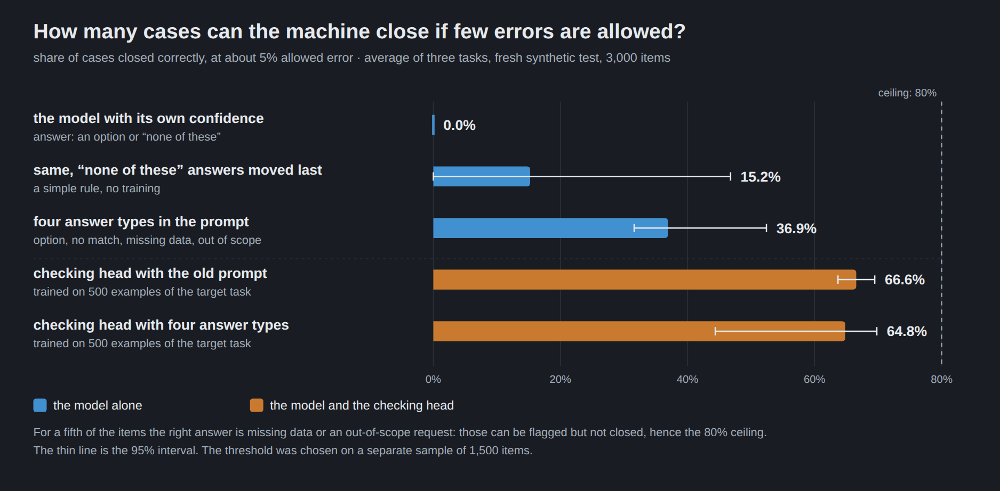
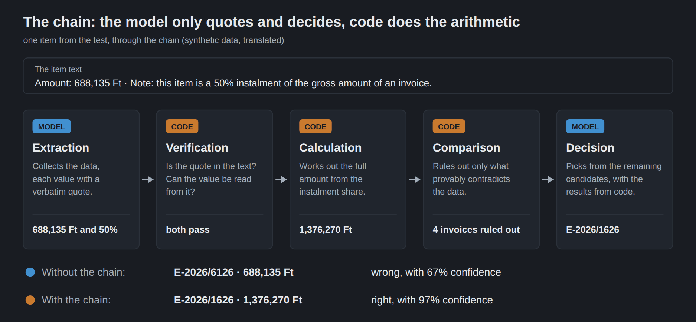
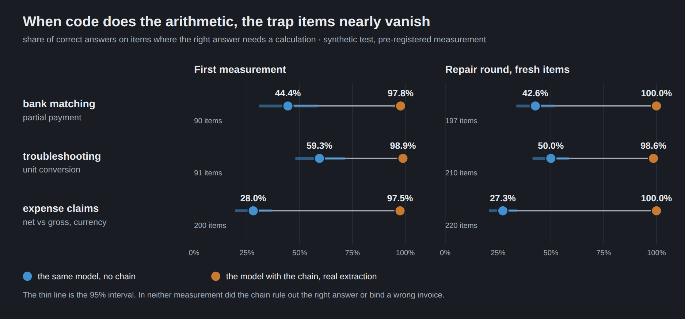
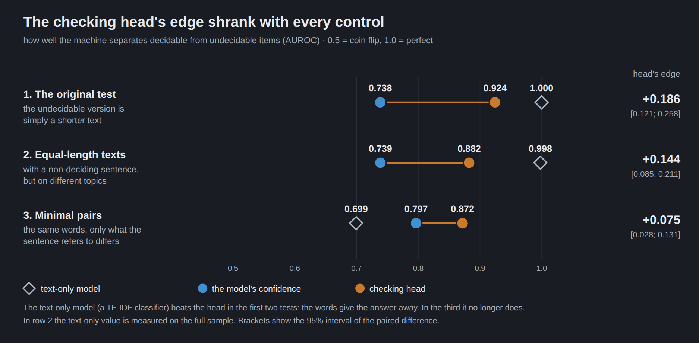

# A verified computation chain before the decision model, and what is left of a checking head after a control — four pre-registered rounds on synthetic decision tasks (Qwen3.6-35B-A3B-FP8, GB10)

**Date:** 2026-10-29 → 2026-11-08 · **Reproducibility:** R2 (code, generators, frozen protocols, manifests and aggregate machine outputs are here; the synthetic item files, generated texts and per-item extractions, read-outs and scores are not published, so the numbers are checked by hash and against the machine outputs, not recomputed; see §7) · **Card:** [eval-card.yaml](eval-card.yaml) · **Decision:** [decision-record.md](decision-record.md) · **Pre-registered protocols (Hungarian):** [protocol/](protocol/) · **Article:** [What you can compute, don't train](https://docai.hu/en/blog/dont-train-what-you-can-compute) ([Hungarian](https://docai.hu/blog/amit-ki-lehet-szamolni)) · **Previous round:** [general-decision-lora-negative-gb10](../2026-10-15-general-decision-lora-negative-gb10/)

> A language model that decides by a single label token makes confident mistakes. This package covers four pre-registered rounds that looked for a remedy. Round 05a: a frozen head on the model's internal states does not transfer to held-out task families (a pre-registered negative). Round 06: a small reliability head trained on 500 target-domain examples cuts the risk to about a fifth, but most of that gain was the head learning *when deciding is justified*, and a one-line rule gets 72% of it. Round 07: a four-state prompt helps, the head still adds on top, and on trap items that need a calculation (partial payment, unit conversion, net versus gross, currency) neither the model's own confidence nor the head recognises the error. Round 08: if code does the calculation between extraction and decision (a *verified chain*), the share of correct answers on those trap items goes from **28–59%** to **97.5–98.9%**, with no false exclusion and no false binding; a repair round on fresh items meets the pre-registered target on all three task families (false passes 0 / 197, 0 / 210 and 1 / 220, correct **98.6–100.0%**). **All of this is synthetic; the chain's value lies in trap items, and on a natural mix it adds no coverage by itself** (§5.6). The checking head was tested on the error code cannot fix: undecidable items. The pre-registered gain (AUROC +0.186, Holm interval [0.111; 0.269], plain 95 % interval [0.121; 0.258]) is arithmetically right but measures a construction artefact: a text-only TF-IDF classifier scores 1.000 on the same set. With a pre-registered matched control the reading stayed "not evidence"; with minimal pairs the gain shrinks to +0.075 [0.028; 0.131] (text-only 0.699) and the head's claim stands in a narrowed form, unusable at the operating point. No product use follows from the head.

---

## 1. What was the measurement for?

DocAI decides by a language model: a case (a bank transaction, a fault report, an expense claim) and a few options, one label token, and a confidence value. Closing cases automatically needs a threshold on that confidence, and rounds [03](../2026-10-15-general-decision-lora-negative-gb10/) and before showed that a threshold fitted on one kind of data does not carry over to another, mostly because of confident "none of these" and misread decisions. Four questions followed (internal round numbers):

- **Round 05a (2026-10-29):** a small head on the frozen model's hidden states and attention, with a reliability head on top, trained on many task families. Does it give held-out task families more correct automatic decisions than the calibrated base model, at equal precision?
- **Round 06 (2026-10-31):** can a reliability head trained on a few hundred target-domain examples rank a fixed base model's answers better than the model's own confidence, on three fresh synthetic families? And how much of the gain is the head learning the labels' convention?
- **Round 07 (2026-11-01, K3 2026-11-01):** does a four-state prompt (choose an option / none is suitable / a needed datum is missing / out of scope) by itself bring the 06 head's gain, does the head add on top of it, and do either of them recognise a mistake that comes from skipping a calculation step (K3, trap items)?
- **Round 08 (D12 2026-11-04; repair round J 2026-11-05; controls M 2026-11-06, N 2026-11-08):** if verified code performs the calculation before the model decides (the **chain**), does the trap-item mistake disappear (K2), and does a head trained on the remaining errors recognise what the chain cannot fix (K1; K3 on a natural mix)?

Each round's rules were frozen before the outcome data were seen: the hypotheses, endpoints, statistics, reading tables and analysis code, with sha256 manifests ([protocol/rogzites/](protocol/rogzites/)). What changed afterwards is dated in the protocols, mistakes included. The freeze times (all from the records in `protocol/rogzites/`):

| round | frozen at (record) | what the freeze covered |
|---|---|---|
| 05a | 2026-10-29 12:41 ([ROGZITES.json](protocol/rogzites/kor05/v1a/ROGZITES.json)) | v1a: rules, code, heads, calibration; hold-out read-outs sealed |
| 06 | 2026-10-31 09:15 ([record](protocol/rogzites/kor06/v1/ROGZITES.json)) | v1 (41 files); F5 read-outs sealed |
| 07 | 2026-11-01 09:42 ([record](protocol/rogzites/kor07/v1/ROGZITES.json)) | v1 (157 files); read-outs sealed |
| 07 K3 | 2026-11-01 19:45 ([record](protocol/rogzites/kor07/k3/ROGZITES.json)) | the K3 analysis and generators, before the trap-sample read-out |
| 08 D12 | 2026-11-04 10:16 ([manifest](protocol/rogzites/kor08/D12/manifest.json)) | K1, K2, K3 rules, chain code, analysis code, 65 files and 23 data files; read-outs sealed |
| 08 J | 2026-11-05 22:10 ([manifest](protocol/rogzites/kor08/J/manifest.json)) | repair round: rule and code, before the fresh sample was generated |
| 08 M | 2026-11-06 10:32 ([manifest](protocol/rogzites/kor08/M/manifest.json)) | matched control: rule, before the read-out |
| 08 N | 2026-11-08 09:11 ([manifest](protocol/rogzites/kor08/N/manifest.json)) | minimal-pair control: rule, before the read-out |

Round 07B and round 08's K4/K08V (real bank items) were scoped as development and feasibility work, not as confirmatory rounds; see §5.8.

## 2. On what task and dataset?

The decision has the form of the previous rounds: a state, a question and options (`A`–`J`), with `X` ("none is suitable") and, from round 07 on, `Y` ("a needed datum is missing") and `Z` ("the request is out of scope"). The answer is one label token; its probability is the base confidence.

**Held-out data (05a).** Three layers reused from round 03: HO-termék (n = 3854 scored items), HO-routing (n = 6659), HO-új (n = 1900); each scored with strict correctness (the `NONE` answer is only right on `NO_MATCH`). Plus a 500-case target-family sample per layer for the fine-tuning arms.

**Synthetic data (06, 07, 08).** Three fresh families: bank matching (`penzugy.bankparositas`), fault diagnosis (`muszaki.hibaelharitas`), expense-rule compliance (`szabaly.koltsegelszamolas`); half Hungarian, half English; fixed composition MATCH 60 / NO_MATCH 20 / MISSING_DATA 10 / OUT_OF_SCOPE 10 %.

- **Text generation:** Muse-Glimmer-30B (Apache-2.0 per its model card, a different family from the subject; revision `a4e59da52a7bc87ae7251dd5545c0dd437c44b68` in round 08), from a detailed plan in which the correct answer is known before the text is written. The subject's Qwen family neither generated nor labelled any data.
- **Labels:** from the construction (the generator's plan and a fact-checker), not from a model's judgement. A Gemma 4 pass is a triage only (the Gemma frame has no missing-data option, so it answers on those items anyway; it does not delete items and is not a label source).
- **Sizes:** round 06 trained on up to 500 examples per family (T500) and tested on 1000 items per family (TESZT, 60 template groups, disjoint from training); round 07 used fresh CAL 500 + TESZT 1000 per family from new templates, its K3 trap sample has 186 / 182 / 199 items (bank, fault, rule; four variants: partial payment, unit conversion, net/gross, currency); round 08 used fresh CAL 500 + TESZT 1000 per family, K3-type trap items n = 90 / 91 / 200, an interpretation test of 2204 items for the rule family (551 units, 40 template groups; 256 and 248 items for bank and fault), a separate interpretation training set (1980 / 648 / 360 items, disjoint templates), and the repair round's 197 / 210 / 220 fresh trap items.

Labels are not assumed correct. The blind human audits, and what went wrong in them (see [results/audit_osszesito.json](results/audit_osszesito.json) for the counts; the audit pages and per-item decisions are not published):

- **Round 06:** first audit 12 label errors in 300 (upper bound 6.40 %, the 2 % gate failed: the rule family's domestic-travel wording and ambiguous bank-row roles); corrected constructions; second audit 1 / 300, upper bound 1.57 %, gate passed.
- **Round 07:** 0 / 300, upper bound 0.99 %.
- **Round 08, G1 pilot (D7):** 5 / 115 label errors (gate failed, upper bound 8.92 %), design error rate of 6.9 % in the audited rule family, then corrected, closed at 115 / 115 before D12.
- **Round 08, G2 test (2204 / 256 / 248 items):** random sample 0 / 30 for the rule family [0.0%; 11.4%], 2 / 30 = 6.7 % for bank [1.8%; 21.3%], 3 / 30 = 10.0 % for fault [3.5%; 25.6%]; 8 faulty units removed; audits finished before any read-out.
- **Round 08, K3-type items and round 07 K3 trap items:** no blind audit (construction gold, a hand check of 16 items for K3). Repair round J: no audit (its false-pass endpoint does not depend on the label).
- **Minimal pairs (control N):** the first blind audit **failed its gate, 3 / 30** (limit 2); all three were generation errors; a structural filter was written from those errors and the sample re-audited on a fresh 30, **0 / 30**, passed. Because the filter was built from the first audit's errors, only the second 30 is evidence for it. This audit is the control's weakest point (see §7).

**Real bank items (07B, K08V; development numbers).** 262 bank transactions of one contributing company, from June to September 2026, labelled blind by one person, with the product's candidate list. Items and labels stayed on our own machines; only aggregates appear here (`results/kor07/B7/vegleges.*`, `results/kor08/V/`). These are **development numbers**: the sample and the labels are known, and the thresholds in K08V were chosen on this sample. We do not name the company.

## 3. Which models and configurations were compared?

- **Subject:** `Qwen/Qwen3.6-35B-A3B-FP8` (MoE, 35 B), thinking off, one forward pass, label-token log-probabilities, on one DGX Spark (GB10, 128 GB). Chain extraction on vLLM 0.30.0 at temperature 0 with a fixed JSON schema; hidden states and head scores on an FP8-faithful BF16 Hugging Face copy, with a determinism guard (a 50-item reference slice must be bitwise identical to its reference at the start and at the end of each read-out; otherwise the run stops, and the numeric mode is decided on the reference slice at the start of the process; see §7).
- **Arms, round 05a** (D_fit / D_meta / D_cal slices of round 03): `C` (content and reliability heads on logit features), `H` (`C` plus hidden states of layers 20, 28 and 40; the selected architecture, called K*), `A` (plus attention features), `HX` (all non-MATCH states merged into one `X`); calibrated base read-outs `B0` (one order, temperature) and `B1` (four-order average, temperature), `L1v` and `G3` (round 03's vLLM read-outs, three seeds), external `JEV-35B` (`JEV-a`, `JEV-b`); target-family arms `B1-T`, `H-T-kal` (Platt and τ on the 500-case target-family sample), `H-T-meta` (the reliability head tuned on that sample, with grouped cross-fitting).
- **Arms, round 06:** `B1-S` (the base model's own score), `B1-N` (B1 with `NONE` answers moved last, no training), `B1-LR` (5-feature L2-logistic), `B1-R|T500` (head: pre-trained on D_meta, tuned on T500, 3 seeds), `B1-R0` (no target examples).
- **Arms, round 07:** same plus four-state prompt `B1-4S`, `B1-4R`, `B1-4LR`, `B1-4R0`; the head is pre-trained on D_meta, tuned on the 06 T500, hidden states of the chosen-answer position; 5 folds.
- **Arms, round 08:** after the chain: `L-S` (the model's own score), `L-R07` (frozen 07 head), `L-R` (head on the chain's T500), **`L-RN`** (same, T500 and the interpretation training set weighted 50–50 %), logistic `L-LR` and `L-LRN`; without the chain: `B1-4S`, `B1-4R`.
- **The chain:** see [code/kor08/eszkozok/lanc08.py](code/kor08/eszkozok/lanc08.py) (and `lanc08j.py` for the repair round). The model only quotes: it extracts fields with verbatim source spans; code checks that the span is in the text, reads the value, applies the arithmetic (full amount from an instalment rate, unit conversion, net from gross, currency) and compares each candidate with the result. It rules a candidate out only on proof, binds only when exactly one candidate's invoice number is in the note and the amount and partner agree (bank family), and discards what fails. Missing data rules nothing out; a contradiction goes to a human.

## 4. Which metrics?

- **AURC** (area under the risk–coverage curve of the decisions) and its reading: the smaller the better; **E-AURC** subtracts the arm's best attainable ordering; **SELECT-AURC** on selecting decisions only.
- **Coverage at the working point (`hasznos lefedettség`):** the share of all items that the arm closes correctly at a threshold τ chosen on the calibration set by the rule "the largest accepted set with a one-sided 95 % Clopper–Pearson lower bound on closure precision ≥ 0.95, with at least 200 closed items, only on the model's own closable decisions". **Closure error rate:** closed-and-wrong over all closed. No working point: the arm closes nothing from the model, which is reported, not patched. A chain binding counts as a closure.
- **K2 (the chain):** on the K3-type items, the share of correct final decisions without the chain, with the chain on real extraction (`kinyert`), and with the chain on oracle fields from the plan (`orakulum`); the difference between the last two is the extraction loss; **false pass:** the chain's output differs between real and oracle extraction while the item is not sent to a human (denominator: items passing the check); **false exclusion** (gold removed) and **false binding** (bound to the wrong invoice) are separately checked. Targets: correct ≥ 90 % and false pass ≤ 2 % (point estimates).
- **K1 (the head, after the chain):** among items with no decision-relevant extraction error. K1(b): AUROC of wrong against correct selections among decidable items. K1(a): AUROC of the undecidable versions' selections against the decidable versions' correct selections. Pre-registered reading tables are in `protocol/rogzites/kor08/G1-rogzites.md` §8 (AUROC 0.60 and ΔAUROC 0.05 thresholds, Holm on the two main pairs).
- **Naming:** `K3` in round 07 is the trap-item diagnostic; in round 08 `K3` is the natural-mix endpoint and the "K3-type" items are the trap items, `K1` and `K2` as defined above.
- **Statistics:** template-group (or case, for 05a: family → case) clustered bootstrap, 10 000 replicates, τ re-chosen in each replicate only on the calibration resample; intervals are 95 % (97.5 % for the Holm-reading pairs where stated). 05a reports strict correctness as the verdict and leaves the "lenient" variant descriptive; intervals are conditional on the numeric mode and calibration choices.

## 5. What was the result?

The per-round hand-written results pages (Hungarian) are in [protocol/](protocol/); the machine outputs are in [results/](results/). All numbers below are from those JSON files; `code/verify_package.py` recomputes the headline ones.

### 5.1 Technical closure

All seal manifests and analysis chains ran with the freeze checks green (round 07 F5: 1308 numbers reproduced by re-running the frozen analysis after an edit of the frozen file was reverted; round 08: 480 sealed files, 6.48 GB, 0 differences). Round 08's first two closed read-outs stopped on the determinism guard (numeric modes A and B); the project owner decided to determine the numeric mode first (§7, process errors); the result is reported in all three modes.

### 5.2 Round 05a: a frozen head does not transfer

ΔAURC (S+N, smaller is better) against the calibrated base `B1` on the three filter layers; n = 3854 / 6659 / 1900 ([results/kor05/F3/v1a/elemzes05.json](results/kor05/F3/v1a/elemzes05.json), machine sheet `eredmenylap_gepi.md`):

| contrast | HO-termék | HO-routing | HO-új |
|---|---|---|---|
| H − B1 (S3, filter; precision of H) | +0.0230 [0.0159; 0.0292] (0.974) | −0.0909 [−0.1080; −0.0699] (0.899) | +0.0179 [−0.0013; 0.0525] (0.909) |
| H-T-meta − B1-T (S5, filter) | | −0.1428 [−0.1527; −0.1332] | |

The pre-registered rule required, on at least two of three layers, a ΔAURC (S+N) interval below zero, precision ≥ 0.93 at the arm's own threshold where it has a working point, and the MTX guard (confident wrong acceptances of `X` items) not significantly worse. **The result is "does not advance" for S3 on 0 of 3 layers and for S5 on 1 of 3 (only HO-routing).** H's better position on HO-routing comes from the strict-correctness convention: under lenient correctness H − B1 is +0.0467 [0.0106; 0.0705] there (the machine sheet's lenient table), so the base ordering is the better one; the `05b` confirmatory gate stayed closed and the broad data-building round was not started. External reference JEV-35B (H6, Holm over 2 × 3): better on HO-termék than both L1v (−0.0078 [−0.0107; −0.0050]) and G3 (−0.0166 [−0.0254; −0.0065], precision 0.996); on HO-routing "not satisfied" against L1v (−0.0515 [−0.0600; −0.0431], precision 0.787) and worse than G3 (+0.0212 [0.0052; 0.0343]); on HO-új not decidable against either (−0.0143 [−0.0290; 0.0217]; −0.0062 [−0.0195; 0.0455]). At JEV-a's working point on HO-termék 1262 of 3854 items are accepted (32.7%) with 5 errors (99.6%); that working point is fragile (in about a third of bootstrap replicates no working point exists; [results/kor05/F3/v1a_diag/jev_merleg05.json](results/kor05/F3/v1a_diag/jev_merleg05.json), post hoc).

Post-hoc diagnostic ([results/kor05/F3/v1a_diag/diag05.json](results/kor05/F3/v1a_diag/diag05.json), not a verdict): on HO-termék the H − B1 gap (+0.023) splits into the proposals (+0.012: H proposes correctly 76.3 % against B1's 81.2 %) and the ordering (+0.011: the reliability head improves on the content head's own probability by −0.011 but does not reach B1's ordering); on HO-routing the proposals are about equal (−0.003) and the gain is the ordering (−0.088 of −0.091, already present in the content head's own probability).

### 5.3 Round 06: the head works on the target domain, but the gain is largely one rule

AURC under strict correctness on the fresh TESZT, three families (bank, fault, rule), [results/kor06/F5/f5_elemzes.json](results/kor06/F5/f5_elemzes.json):

| arm | bank | fault | rule |
|---|---|---|---|
| B1-S | 0.1422 | 0.2478 | 0.3037 |
| B1-R (T500) | 0.0480 | 0.0442 | 0.0498 |
| ΔAURC [95 %] | −0.0942 [−0.1114; −0.0786] | −0.2036 [−0.2307; −0.1773] | −0.2539 [−0.2778; −0.2270] |

The pre-registered rule (≥ 2 families improving and ratio ≤ 0.90 with upper bound < 1) is met on all three: the average ratio is **0.205 [0.187; 0.224]**. Moving the base model's `NONE` answers last with no training (B1-N) gives 72% of the average gain ([results/kor06/F5/f5_bontas.json](results/kor06/F5/f5_bontas.json)). Under lenient correctness (any `NONE` on a non-MATCH item is right) the ratio is 0.965 [0.881; 1.063]: the gain is mostly the head learning the convention. The SELECT ordering improves too (on two families more than the logistic baseline). At the working point (descriptive, [f5_munkapont.json](results/kor06/F5/f5_munkapont.json)) the base model has no working point on any family; B1-R covers 0.665 [0.582; 0.732] at precision 0.983 [0.957; 0.995] on bank, 0.679 [0.618; 0.763] at 0.975 [0.940; 0.990] on fault and 0.717 [0.670; 0.746] at 0.967 [0.950; 0.982] on rule.

### 5.4 Round 07: a four-state prompt helps, the head still adds

On a fresh test (AURC on the K1 pairs, [results/kor07/F5/elemzes.json](results/kor07/F5/elemzes.json)): the head on the four-state prompt (B1-4R) against the prompt's own score (B1-4S) has the ratio **0.507 [0.459; 0.562]** (rule met, all three families). Working-point coverage, average of three families, at the K2 rule (τ on the calibration set):

| arm | average useful coverage | closure error |
|---|---|---|
| B1-S | 0.0 % (no threshold) | – |
| B1-N | 15.2 % | |
| B1-LR | 51.2 % | |
| B1-R (06 head) | **66.6** % | 2.9% |
| B1-4S (four-state prompt alone) | 36.9 % | no working point on bank |
| B1-4R (head on the four-state prompt) | **64.8** % [44.4; 69.8] | 2.5% |

The prompt alone does not bring the head in (−29.6 points [−34.2; −15.2]); the head improves on top of the prompt (+27.9 points [7.8; 33.5], closure error 2.5%), and it is roughly equivalent to the 06 head in closures (−1.7 points [−21.4; 2.0]); the four-state head's addition is the state signal (on fault and rule, not on bank). The bank family's operating point is fragile (no threshold in 18 % of replicates).



### 5.5 Round 07 K3: trap items, and a paired test with a computed line

K3 items are all decidable and need a calculation step; a decoy option matches on the surface. On these, neither the model's confidence nor the head recognises the error ([results/kor07/K3/](results/kor07/K3/), the pre-registered K3 analysis and the two post-hoc additions):

- AUROC separating wrong from right selections, four-state frame, average of families: B1-4S 0.413 [0.363; 0.462] (reversed: more confident on the decoy), B1-4R 0.452 [0.393; 0.507] (no better than chance), ΔSELECT-AURC −0.053 [−0.091; −0.013]. On bank B1-4R is 0.211: more reversed than the model itself.
- With the unchanged thresholds the head closes the trap items at a very different error rate from the natural mix (post hoc, [munkapont/](results/kor07/K3/munkapont/munkapont.md)):

  | family | wrong closures, natural test | wrong closures, trap items |
  |---|---|---|
  | bank | 2.5% | 100% (11 / 11) |
  | fault | 1.3% | 27% (16 / 60) |
  | rule | 3.8% | 81% (122 / 151) |

- **Paired test (post hoc, exploratory, an upper bound):** the same items with one extra line stating the result of the missing step, computed by code from the plan ([aug/](results/kor07/K3/aug/aug.md)): correct answers rise from 29% to 100% (bank; here the computed amount literally equals the correct option), 52% to 94% (fault), 24% to 67% (rule; the remaining errors are threshold comparisons, not arithmetic).

### 5.6 Round 08: the chain (K2, J) and its limits on a natural mix (K3)



**K2, trap items, three paths** ([results/kor08/G5/k2/g5_k2.json](results/kor08/G5/k2/g5_k2.json), n = 90 / 91 / 200):

| family | without chain | chain, real extraction | chain, oracle fields | extraction loss | false pass | target (≥ 90 % correct, ≤ 2 % false pass) |
|---|---|---|---|---|---|---|
| bank | 44.4% | 97.8% | 98.9% | 1.1 points | 1 / 90 = 1.1 % | met |
| fault | 59.3% | 98.9% | 100.0% | 1.1 points | **3 / 91 = 3.3%** | **false-pass target not met** |
| rule | 28.0% | 97.5% | 98.0% | 0.5 points | 0 / 199 | met |



False exclusion and false binding: none on any path. In short: correct answers from 28–59% to 97.5–98.9%; extraction costs 0.5–1.1 points against perfect fields. The four false passes are all extraction errors the check caught (the field was discarded, the item went to the model without the chain's help; published as an aggregate statement, the per-item list is not published). This pre-registered target failure on the fault family led to the repair round.

**The repair round J** ([results/kor08/J/k2/g5_k2.json](results/kor08/J/k2/g5_k2.json), [protocol/rogzites/kor08/J-rogzites.md](protocol/rogzites/kor08/J-rogzites.md)): two changes to the check only (quote localisation insensitive to accents and case; a converted measurement traced back to the number in the text), pre-registered with a stricter rule than D12: fresh templates (disjoint from G2), n = 197 / 210 / 220, a **new pre-registered condition**: correct ≥ 90 %, false pass ≤ 2 %, **and no false exclusion and no false binding** (added because the fix relaxes the check).

| family | without chain | chain, repaired | false pass (repaired) | frozen chain on the same extraction |
|---|---|---|---|---|
| bank | 42.6% | 100.0% | 0 / 197 | 0 / 197 |
| fault | 50.0% | 98.6% | 0 / 210 | **5 / 210 = 2.4%** |
| rule | 27.3% | 100.0% | 1 / 220 = 0.5% | 1 / 220 |

Correct 98.6–100.0%, no false exclusion or binding: **the rule is met on all three families.** The frozen chain would have failed the target on fault. This round did not re-measure K1 or K3. Two extraction error types are not fixable this way and remain (reading "80 mOhm" for "800", treating "40%" as an amount).

**K3, natural mix, 1000 items per family** ([results/kor08/G5/k3/g5_k3.json](results/kor08/G5/k3/g5_k3.json); `--tau-halmaz rendszer` sensitivity in `k3_rendszer/`). Coverage [95 %] / closure error:

| arm | rule family | fault family |
|---|---|---|
| chain + model (L-S) | 62.6% [53.6; 65.1] / 4.7% | 62.9% [58.0; 68.0] / 4.1% |
| chain + head (L-RN) | 71.9% [69.8; 74.1] / 3.1% | 67.6% [64.5; 69.6] / 3.6% |
| chain + T500 head (L-R) | 72.5% [70.4; 74.5] / 2.4% | 67.6% [64.4; 69.5] / 4.5% |
| no chain, 07 head (B1-4R) | 71.9% [67.5; 74.4] / 2.7% | 71.2% [55.9; 72.9] / 5.5% |

L-RN − L-S: +9.3 points [7.4; 18.1] on rule, +4.7 points [0.2; 9.2] on fault; L-R − L-S gives the same (+9.9 points, +4.7 points). So the gain is not the targeted training: the plain T500 head delivers it. The chain does not add coverage on a natural mix by itself: on the rule family the no-chain 07 head closes as many cases. On the bank family the chain binds 363 / 1000 items with 0 wrong bindings (that is its full contribution, and there is no model working point for the chained arms, in 100 % of replicates; the no-chain B1-4R covers 53.2% [15.4; 61.1] at 1.2% closure error). The chain's value is on trap items, which are rare in natural traffic, and in safety.

### 5.7 Round 08: the head on what the chain cannot fix (K1, and two controls)

The question is whether the head recognises undecidable items (K1(a)) and rule-based misreadings (K1(b)). K1(b): L-RN 0.927 [0.885; 0.975] against L-S 0.890 [0.834; 0.981], Δ +0.036 [−0.047; 0.086], reading **not decidable** (the error events are concentrated in a few templates). K1(a), pre-registered main pair: L-RN 0.924 [0.883; 0.957], L-S 0.738 [0.647; 0.822], **Δ +0.186 [0.121; 0.258]**, Holm interval [0.111; 0.269], reading "improves materially". ([results/kor08/G5/k1/g5_k1.json](results/kor08/G5/k1/g5_k1.json); the 95 % interval is printed with the Holm one.)

That number is arithmetically right and measures a construction artefact. A text-only TF-IDF classifier, trained on the training set and evaluated on the same K1(a) set, scores **1.000** ([results/kor08/G5_utolagos/felszin/felszin.json](results/kor08/G5_utolagos/felszin/felszin.json); post-hoc run, with the reading of the result fixed before the run): the undecidable version is simply the shorter text without the deciding sentence, so separating them does not require understanding anything. By the reading fixed before this run (best text-only model ≥ 0.85), the claim does not hold in this form.



Two further controls, separately pre-registered, with the heads frozen:

| K1(a) on the rule family | G5, original (a) | M, matched long (a) | N, minimal pairs |
|---|---|---|---|
| L-RN | 0.924 [0.883; 0.957] | 0.882 [0.832; 0.925] | 0.872 [0.823; 0.914] |
| L-S | 0.738 [0.647; 0.822] | 0.739 [0.652; 0.820] | 0.797 [0.734; 0.855] |
| **L-RN − L-S** | **+0.186 [0.121; 0.258]** | **0.144 [0.085; 0.211]** | **0.075 [0.028; 0.131]** |
| text-only model (G5: char TF-IDF on the K1(a) set; M: fresh template-group CV on the whole sample, the matching gate; N: fresh model on the K1(a) set) | 1.000 | 0.998 | 0.699 |
| undecidable items closed above τ, L-RN / L-S | 43.5 / 43.0 % | 54.6 / 43.9 % | 77.7% / 37.9% |

The controls' verdicts as pre-registered:

- **M (matched control):** the undecidable (a) gets a non-deciding sentence of the same length. Matching gates: length 0.582 (met), the old text-only model 0.841 (limit 0.70, failed), a fresh template-group CV 0.998 (limit 0.80, failed) ([results/kor08/M/felszin/illesztes.json](results/kor08/M/felszin/illesztes.json)). Because matching failed, the protocol's reading of a positive result is "**not evidence**" (the gain could still come from the residual text cues); the question stayed open.
- **N (minimal pairs):** both texts contain one decisive-looking sentence; only whether it refers to the claimed amount differs; matched on length, lexical content and structure (all three gates passed: length 0.506, the old text-only model 0.513, a fresh CV 0.695 on the whole sample; 0.699 on the K1(a) set, [results/kor08/N/felszin/illesztes.json](results/kor08/N/felszin/illesztes.json) and `N/szoveg.json`). The first label audit failed 3 / 30 and the sample was fixed (see §2). Reading: **"the claim stands in a narrowed form"**: this family, this construction, these heads (L-RN − L-S 0.075 [0.028; 0.131], and L-RN above the best text-only model). The question is closed; no further controls.
- At the operating point the head is unusable on this construction (77.7% of the undecidable items closed above τ, against 37.9% for the model's own score). No product benefit is claimed.

### 5.8 Real bank items: development numbers only

262 real bank transactions of one contributing company, one labeller, blind. Aggregates only; the sample and labels are known, and the K08V thresholds were chosen on them: **development numbers, not a confirmatory result.** Round 07B ([results/kor07/B7/vegleges.md](results/kor07/B7/vegleges.md)) ran the frozen synthetic-calibrated models on this sample; round 08's K08V ([results/kor08/V/](results/kor08/V/)) ran the chain.

- The extractor is weak on real payment notes: 93 items have a candidate's invoice number verbatim in the note, the extraction brought out 30 of them and the chain made 22 bindings. Direct search for the candidates' invoice numbers in the note gives 70 bindings, 0 errors (the upper bound of 0 / 70 is about 5 %).
- Chain + model: 2 / 126 = 1.6% closure error, the chain's part 0 / 70, the model's own closures 2 / 56 = 3.6% (above the 2 % development target, and both errors are items the labeller could not decide from the data shown).
- New closures against the existing matcher are 1–3: the matcher already handles this customer's traffic. The SELECT ordering of the head and the model's own score do not differ: AUROC 0.910 and 0.911.

### 5.9 What is post hoc

Not part of any frozen rule, descriptive or exploratory, and reported as such:

- Round 05a: the diagnostic decomposition (`diag05`) and JEV-a's case-level working-point balance (`jev_merleg05`).
- Round 07: the language breakdown, the bank family's exploratory twin-rule analysis (`F5/feltaro`), K3's working-point table and the paired test with a computed line (`aug`).
- Round 08: the item-level review of the K2 false passes and the mode-sensitivity analysis (results page appendix A and B, the latter with the owner's permission before running); the whole-system K1 line (appendix C, mandatory, added after the frozen runner omitted it); the text-only surface control (appendix E, with the reading fixed before the run); the per-unit breakdowns of M (`M/utolagos`), N's pair-clustered sensitivity (`N/erzekenyseg_parklaszter`, Δ 0.075 [0.021; 0.148]), and all real-data work.
- Interpreting across rounds, as this README does, is post hoc by nature.

## 6. What product decision followed?

See [decision-record.md](decision-record.md). In short: the chain's next step is a fresh real-data sample of about 150 bank items with a pre-registered threshold, and the claim about the chain stays synthetic until then. The checking head's question is closed with the narrowed claim above and no product use. The article and this package go out now; a later study will carry a dataset.

## 7. What are the limits of the measurement?

- **Everything except the real-bank development numbers is synthetic,** from one generator model, for three families and two languages, measured on one subject model (Qwen3.6-35B-A3B-FP8), one engine build and one machine (GB10). The trap items are constructed and measure what the system does with a known mistake type, not how frequent it is in real traffic.
- **The chain's claim is synthetic-only.** We do not claim that the chain works on real traffic, and the protocol's own wiring "a passing K2 may go to a product specification" is not acted on here (the G5 results page's line on it is annotated in the published copy). The chain's value lies in constructed hard items and in safety; on a natural mix, K3 shows no coverage gain from the chain alone.
- **Small samples at the K2 scale.** One item moves the fault family by 1.1 points. J's 200-item sample passes its point-estimate target with 95 % probability at a true false-pass rate of 1 % and 63 % at 2 %. Two error types the repair does not fix remain. The J round did not re-measure K1 or K3.
- **The head claims are narrow.** The K1(a) claim is one family, one construction, these heads; K1(b) is not decidable and rests on a handful of templates; the head's closures at the working point are unusable on the N construction; on real items it does not beat the model's own score.
- **Sequential controls on the head.** G5 → M → N are three measurements on one question, with stopping risk ("measure until positive"). Against it: every reading was fixed before its run, each step was stricter, and the effect shrank at each step (0.186 → 0.144 → 0.075). We report all three; N is the main result, G5's number is history.
- **N's weak points.** The structural filter was written from the first audit's errors (only the second 30, 0 / 30, is evidence for it); the second audit's key file sat in the same folder as the page and the composition (14 / 16) was known; N's pre-registration said one test while the analysis ran Holm (the 97.5 % interval holds); the "above the text-only model" condition is a point estimate without an interval, and pair clustering is a sensitivity only (N's clusters share sentences).
- **The labels are not flawless.** G2's random audit found 6.7 % and 10.0 % label errors on bank and fault (only audited items were removed); the rule family's audit found none in 30 but its upper bound is 11.4 %. A "known generation pattern" (a phrase confusing the bank family) was left in place by decision and is flagged in the results page. No blind audit on K3 trap items and on J's fresh items.
- **Determinism and numeric mode.** The HF read-out falls into one of three numeric modes per process. The readings were not changed by the mode (appendix B of the results page), but the closure error on the fault family moved across modes (3.6–5.5 %), so we do not claim a held 5 % there. The heads were trained only on one mode.
- **K3-X** (cross-checking two extractors) was rejected by its descriptive numbers and is not part of the chain's claim.
- **Round 05a's frozen head and JEV comparisons** rest on round 03's reused layers; the design choice to make AURC the primary endpoint of the filter was made after a D_dev trial (reported in `v1a-vazlat.md`).
- **Real data:** one company, four months, 262 known items, one labeller; development numbers; the K08V thresholds were chosen on this sample (07B used the synthetic calibration's); no independent second label; the product's candidate list was used as given; items are not published and neither is the blind labelling sheet.
- **The numbers here are checked, not recomputed.** The synthetic items, generated texts, per-item extractions, read-outs and scores are not published in this package (no Hugging Face dataset or model in this round; a later study will carry a dataset). `code/verify_package.py` verifies the published files against the frozen manifests and the machine outputs and recomputes the headline numbers from the JSON files; the bootstraps and the read-outs need the unpublished items and a GPU.
- **Process errors, found and logged (all in the runbook logs):** in round 07 the frozen analysis file was edited by mistake right after the freeze and restored; a re-run reproduced all 1308 numbers. In round 08 the first two closed read-outs stopped on the determinism guard and were completed through a per-mode procedure (the sealed outputs stayed unread until G5). The K08V first run was discarded (extraction fed the whole transaction line; rerun with the corrected input). Passing an audit covers audited items only.

Files and information not available for this package: the `cache/` directory and everything else held on the measurement host (per-item read-outs, trained heads, feature caches), so those manifest entries stay hash-only; the D12 manifest's `kor08/adat/G1/orakulum_06/...` files are not published, so this package's script cannot check them; on the measurement host all six match the manifest (checked by hand on 2026-11-08), while four older workstation copies do not.

## 8. Which DocAI article belongs to it?

- English: https://docai.hu/en/blog/dont-train-what-you-can-compute
- Hungarian: https://docai.hu/blog/amit-ki-lehet-szamolni
- Earlier rounds: [general-decision-lora-negative-gb10](../2026-10-15-general-decision-lora-negative-gb10/), [decision-lora-where-to-train-gb10](../2026-10-09-decision-lora-where-to-train-gb10/).

## Verify

```bash
python3 code/verify_package.py
```

CPU only, standard library, a few seconds. It checks:

- **the freezes:** each round's manifest hash against its freeze record, the cross-references between the 08 manifests and the G5 opening record, the K3 manifest's reference to the 07 v1 manifest, and every published manifest entry byte for byte (redacted files, listed in `REDACTED` with the reason, are reported as not comparable);
- **the hash files:** `results/kor08/G5/g5.sha256`, and `results/RESULTS.sha256` / `results/PACKAGE.sha256` generated for this package;
- **the numbers:** about 150 headline values recomputed from `results/` and compared with the strings printed in this README, and the eight pre-registration times against the freeze records;
- **privacy:** a scan over every text file of the package for usernames with hosts, home paths, e-mail addresses, access tokens and private addresses. A separate tenant-name scan was run before release and is deliberately not part of this script, because even a hashed list of names could be confirmed by guessing.

Reproducibility of this package is R2: the method can be re-run from the published code and generators; the numbers are checked by hash and against the machine outputs, not recomputed, because the synthetic items, generated texts and per-item outputs are not published here (no Hugging Face dataset or model in this round; a later study will carry a dataset). On 2026-11-08 all checks passed. Not recomputed: the bootstraps and read-outs (they need the unpublished items and the GPU).

Re-running the read-outs needs a GPU, the public base model, and the synthetic items; the generators are in `code/` ([szint06](code/kor06/eszkozok/szint06.py), [szint07](code/kor07/eszkozok/szint07.py), [szint08](code/kor08/eszkozok/szint08.py), with the family plan in [code/kor06/spec/](code/kor06/spec/) and [forgatokonyv08_szab](code/kor08/eszkozok/forgatokonyv08_szab.py)), but a generator run needs the Muse model, the seeds and the fact-checkers, and has not been run for this package.

## Layout

```text
protocol/   the Hungarian runbooks with the full logs (05-runbook.md ... 08-runbook.md, tenant names replaced by <tenant>),
            hand-written results pages (06-F5, 07-F5, 07-K3, 08-G5 eredménylap, 08-onellenorzes-11-08), README.hu.md,
            and rogzites/: the frozen protocols and manifests (kor05/v1a, kor06/v1, kor07/v1, kor07/k3, kor08/...)
code/       kor05/ ... kor08/ (generators, chain, analysis code, runners), eszkozok/ and kor03/eszkozok/ (shared modules),
            abrak08.py and szamellenorzes.py (figures and the article's number check, which assume the research tree),
            verify_package.py
results/    machine outputs by round (kor05/, kor06/, kor07/, kor08/), audit_osszesito.json (aggregate audit summaries derived
            from per-audit outputs), REAL-DATA-NOTICE.md, hash files (RESULTS.sha256, PACKAGE.sha256, kor08/G5/g5.sha256)
figures/    the article's four English figures: chain, closed cases, trap items, head controls
```
